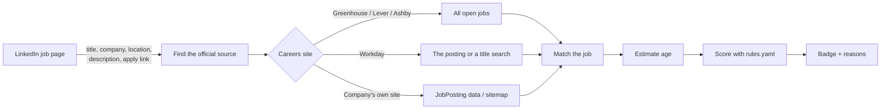

# GhostCheck

**See at a glance whether a LinkedIn job is really hiring.**

GhostCheck is a free, open-source Chrome extension. On every LinkedIn job page it checks the company's own careers site, estimates how long the job has been open, and puts a badge next to the job title:

| Badge | Meaning |
|---|---|
| 🟢 **Likely real** | Listed on the company's careers site, with no warning signs |
| 🟡 **Questionable** | Some signals for, some against (for example, listed but open for months) |
| 🔴 **Suspicious** | Not on the company's careers site, or the apply link is dead |
| ⚪ **Can't verify** | Not enough information. **Never** a judgment against the job. |

Click the badge to see the 3–5 reasons behind it in plain language, plus a link to the job on the company's own site when there is one.

No account, no API key, no server, no cost. Everything runs in your browser.

## Install in 3 steps

1. **Download** this repository: click **Code → Download ZIP** and unzip it (or `git clone` it).
2. Open **`chrome://extensions`** and switch on **Developer mode** (top right).
3. Click **Load unpacked** and choose the **`extension/`** folder inside the download.

That's it: open any LinkedIn job. No `npm install` and no build step. The repository contains the finished extension.

**Updating:** download the new version (or `git pull`), then press the ↻ reload button on GhostCheck's card in `chrome://extensions`.

Works in Chrome 116+ and other Chromium browsers (Edge, Brave, Arc).

## How it works



1. **Read the job.** The extension reads the public job details on the page: title, company, location, description, pay shown by LinkedIn, and the apply link. LinkedIn wraps apply links in redirects; GhostCheck unwraps them.
2. **Find the official source.** The apply link usually reveals the company's applicant tracking system (ATS). Easy Apply jobs have no apply link, so GhostCheck looks the company up in [`data/companies.json`](data/companies.json).
3. **Ask the careers site** through its public API or public pages:

   | Careers site | How GhostCheck checks | Can it say "not found"? |
   |---|---|---|
   | Greenhouse, Lever, Ashby | Full list of open jobs from the public API | Yes |
   | Workday | The exact posting from the apply link, otherwise a title search | Only for boards small enough (≤ 100 jobs) to list completely |
   | Company's own site | schema.org `JobPosting` data on the apply page, then the site's `sitemap.xml` | No: it can only confirm a job, or show the apply page is gone |

4. **Match the job.** Titles are normalized (`Sr.` → `Senior`, `SWE` → `Software Engineer`, noise like `(m/w/d)` or `Remote` removed), then compared with fuzzy matching. Seniority level, location and manager vs. individual-contributor roles must agree. When titles are worded differently, a small AI model that runs on your computer compares the job descriptions (see [below](#description-matching-local-ai-model)).
5. **Estimate the job's age** from the oldest of: the careers site's own publish date, GhostCheck's daily snapshots (`data/first-seen/`), and the earliest [Wayback Machine](https://web.archive.org/) capture. Snapshots and captures prove a job existed *by* a date, so they can show a job is old but never that it is new.
6. **Score it** with the community-editable [`rules.yaml`](rules.yaml):

   | Signal | Points | When |
   |---|---|---|
   | `found_on_official_site` | +3 | The job is listed on the company's careers site |
   | `posted_recently` | +1 | First published within the last 30 days |
   | `salary_listed` | +1 | The posting states a pay range |
   | `specific_team` | +1 | The description names a specific team or project |
   | `not_found_on_official_site` | −3 | Not among the company's open jobs (only when the full list was fetched from a board known to be the company's) |
   | `apply_link_closed` | −3 | The apply link points to a posting that no longer exists |
   | `posted_long_ago` | −2 | Listed for more than 90 days |
   | `generic_template` | −1 | The description reads like a pipeline posting ("talent pool", "future opportunities") |
   | `reposted_to_look_new` | −1 | The careers site shows a much newer date than the job really has |

   A total of **+3 or more is 🟢**, **−3 or less is 🔴**, anything in between is 🟡. If the careers site could not be checked at all, the badge is ⚪, whatever the other signals say.

7. **Cache the result** in your browser for a few hours, so revisiting a job is instant. Click **Recheck** on the card to refresh.

### Why ⚪ "Can't verify" is not bad news

GhostCheck only counts evidence it actually found. A request that failed, a careers site it doesn't support, a similar job in a different location, a site that blocks automated reading: all of these give ⚪, never 🔴. "Not found" is only counted when GhostCheck fetched the company's **complete** list of open jobs.

### Company websites need your permission

GhostCheck does not get access to every website when you install it. When a job's apply link goes to a company's own site, the card shows an **Allow checking &lt;site&gt;** button. It opens a small page where Chrome asks you to allow that one site. You can review and remove allowed sites on GhostCheck's options page.

### Description matching (local AI model)

Companies sometimes title a job differently on LinkedIn and on their careers site ("Member of Technical Staff" vs. "Software Engineer, Payments"). When the title alone is not conclusive, GhostCheck compares the descriptions with a small sentence-embedding model ([all-MiniLM-L6-v2](https://huggingface.co/Xenova/all-MiniLM-L6-v2)) that runs **on your computer** through [Transformers.js](https://github.com/huggingface/transformers.js).

- Text that all of a company's postings share (about us, benefits) is removed first, so only the role-specific part is compared.
- The model can only *confirm* a job or choose between near-identical titles. It never makes a job look worse.
- On 224 postings from 9 live job boards, it confirmed 72% of reworded titles and matched a different job 0 times ([`scripts/eval-semantic.mjs`](scripts/eval-semantic.mjs)).
- The code ships with the extension. The model weights (~23 MB) are downloaded from Hugging Face the first time they are needed and cached by your browser. You can turn the model off, or delete it, on the options page.

## Privacy

GhostCheck reads **only the public job details** on the LinkedIn page you are viewing. It never reads your profile, messages, connections, résumé or anything else about your account, and it never sends LinkedIn cookies anywhere.

| GhostCheck contacts | What it sends | Why |
|---|---|---|
| Greenhouse, Lever, Ashby, Workday public APIs | The company's board id; for Workday, the job title as a search term | Get the company's open jobs |
| A company's own careers site (only after you allow it) | A request for the public apply page and sitemap | Confirm the job is listed |
| archive.org | The public URLs of the job (careers page and `linkedin.com/jobs/view/<id>`) | Find the earliest archived copy |
| raw.githubusercontent.com (this repository) | Nothing but the file request | Latest company list and daily snapshots |
| huggingface.co | Nothing but the file request (once) | Download the description model |

- Job descriptions are compared **on your computer** and never uploaded.
- Results are cached only in your browser (`chrome.storage.local`).
- There is no GhostCheck server, no analytics and no tracking.
- All code is bundled in the extension; nothing is loaded from a CDN or executed from the network.

## Contributing

Pull requests are welcome. The two easiest ways to help need no JavaScript.

### Add a company (for Easy Apply jobs)

Easy Apply jobs have no link to the careers site, so GhostCheck needs to know where each company hires. Add an entry to [`data/companies.json`](data/companies.json):

```json
{ "name": "Acme", "aliases": ["Acme, Inc."], "linkedin": ["acme-corp"], "ats": "greenhouse", "slug": "acme" }
```

| Field | Where to find it |
|---|---|
| `name`, `aliases` | The company name as LinkedIn shows it, and other spellings |
| `linkedin` | The id in the company's LinkedIn URL: `linkedin.com/company/`**`acme-corp`**`/` (optional, but more reliable than the name) |
| `ats` + `slug` | From the company's job pages:<br>• Greenhouse: `boards.greenhouse.io/`**`acme`** or `job-boards.greenhouse.io/`**`acme`**<br>• Lever: `jobs.lever.co/`**`acme`**<br>• Ashby: `jobs.ashbyhq.com/`**`acme`** |
| Workday | `"ats": "workday", "slug": "<tenant>", "workday": { "host": "<tenant>.wd5.myworkdayjobs.com", "site": "<site>" }` from a URL like `https://`**`acme`**`.wd5.myworkdayjobs.com/en-US/`**`AcmeCareers`**`/job/...` |
| `region` | `"eu"` only for EU-hosted Greenhouse or Lever boards (`job-boards.eu.greenhouse.io`, `jobs.eu.lever.co`) |

When you open the pull request, GitHub Actions checks every board against the live API and confirms the Greenhouse board name matches the company. Once merged, everyone's extension picks up the new list within a day, without an update.

### Change how jobs are scored

Every signal, weight, threshold and reason text lives in [`rules.yaml`](rules.yaml). Edit it, explain your reasoning in the pull request (real examples help), and run the tests (see below). If you change a weight, update the scoring table in this README too; a test checks they agree.

### Fix GhostCheck after a LinkedIn redesign

All LinkedIn page selectors are in [`extension/content/selectors.js`](extension/content/selectors.js). Each entry is a list of candidates tried in order, so you can add the new selector at the top without breaking older layouts. Please avoid selectors that depend on visible text: people use LinkedIn in many languages.

### Code changes

```sh
node scripts/sync.mjs                 # after editing core/ or rules.yaml: copy into extension/
node --test                           # unit tests (Node 20+, nothing to install)
node scripts/sync.mjs --check         # fails if extension/ is out of sync (CI runs this)
node scripts/validate-companies.mjs   # check companies.json against the live APIs
node scripts/snapshot.mjs --dry-run   # fetch boards and report snapshot changes
```

`core/` is the source of truth for logic shared by the extension and the scripts. Chrome can only load files inside `extension/`, so `scripts/sync.mjs` copies `core/`, `rules.yaml` and `data/companies.json` there. Never edit `extension/core/` by hand.

To preview every badge state, open `chrome-extension://<extension id>/dev/preview.html`.

| Path | Purpose |
|---|---|
| `extension/` | The ready-to-load extension: manifest, content scripts, service worker, UI, bundled libraries |
| `core/` | Link resolution, ATS clients, matching, age, scoring (shared with scripts and tests) |
| `data/companies.json` | LinkedIn company → careers-site mapping |
| `data/first-seen/` | When each job was first seen; updated daily by [`.github/workflows/snapshot.yml`](.github/workflows/snapshot.yml) |
| `rules.yaml` | Scoring signals, weights and reason texts |
| `scripts/` | Sync, validation, daily snapshot and model evaluation |
| `tests/` | Unit tests; `tests/e2e/` holds a browser test that CI runs with the real model |

## Limitations

- GhostCheck can be wrong. The card says **"Signals, not verdicts"** for a reason: use it as one input, not as proof.
- Careers sites that render jobs only with JavaScript, block automated reading, or use an ATS other than those above give ⚪.
- Large Workday sites (over 100 jobs) can confirm a job but never report it missing.
- The description model understands English only; other languages fall back to title matching.
- LinkedIn changes its pages often. If badges stop appearing, the selectors probably need an update (see [Contributing](#fix-ghostcheck-after-a-linkedin-redesign)).

## License

[MIT](LICENSE). Bundled third-party code (Transformers.js, ONNX Runtime Web, js-yaml) is listed with its licenses in [`extension/vendor/THIRD_PARTY_NOTICES.md`](extension/vendor/THIRD_PARTY_NOTICES.md).
